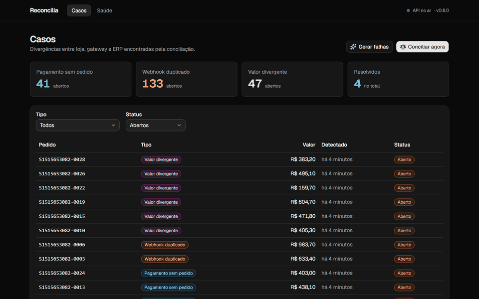
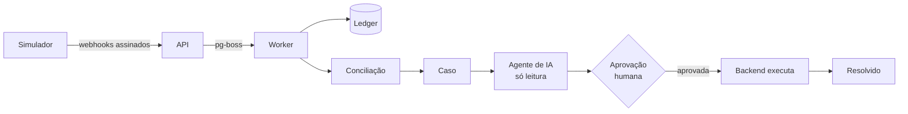
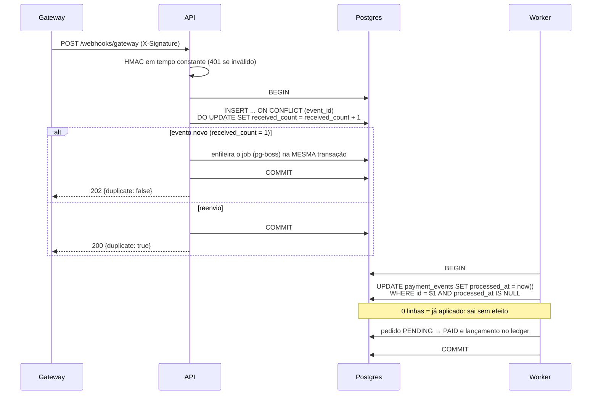
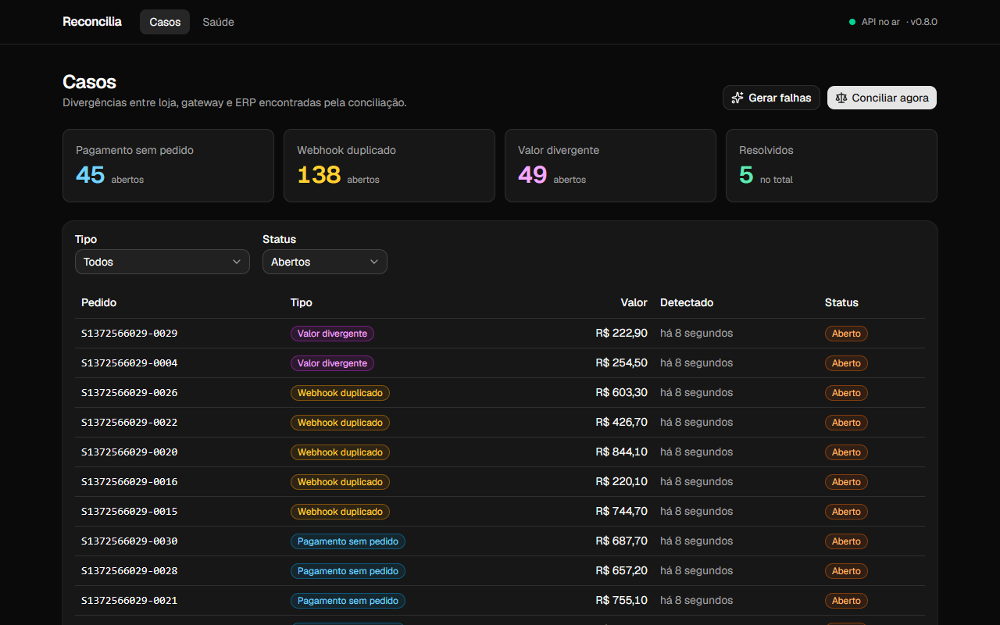
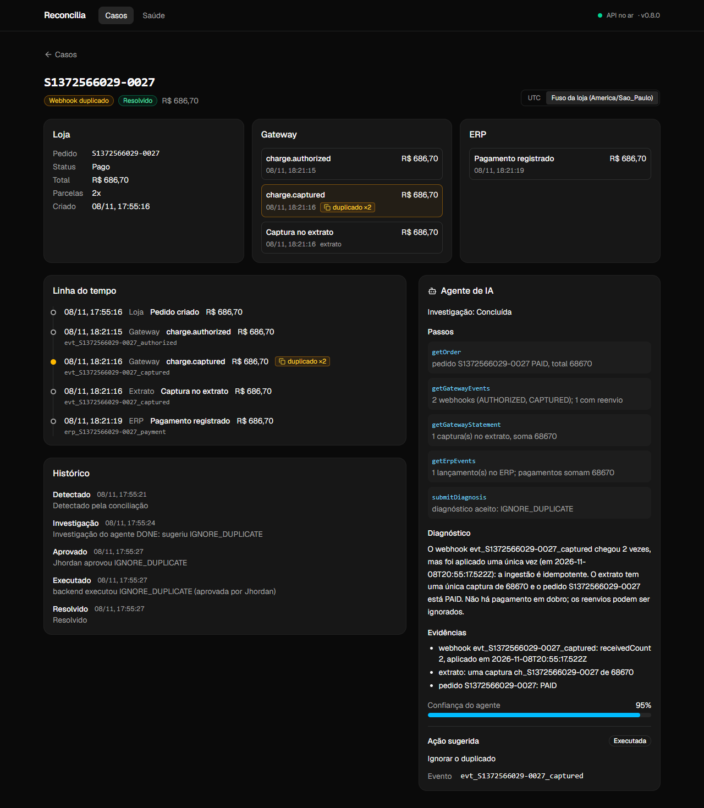
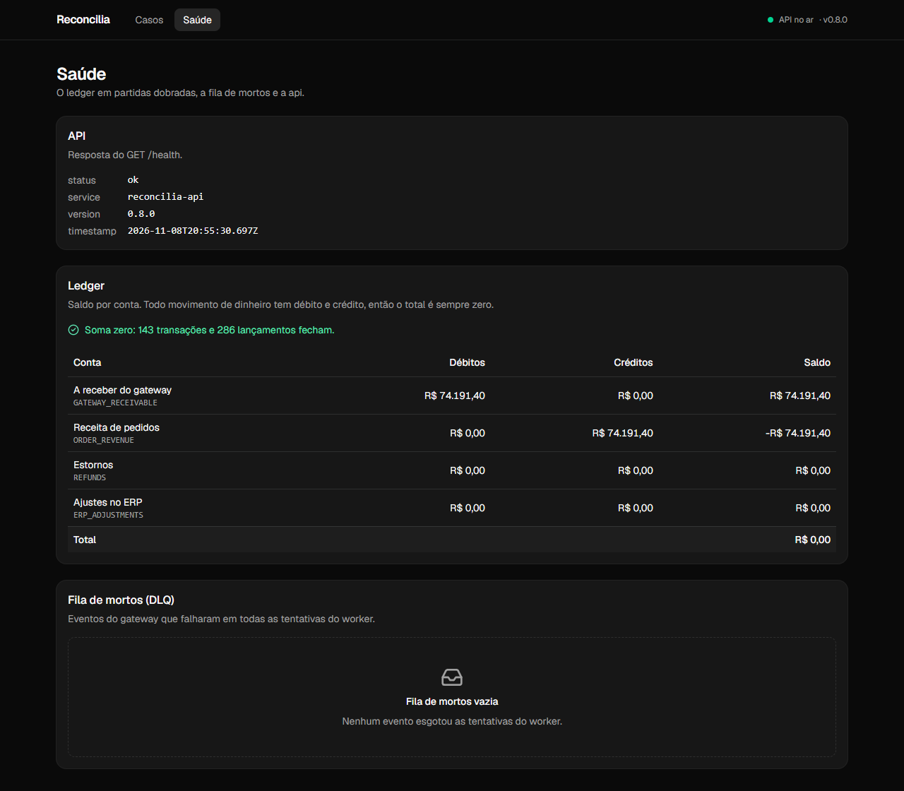
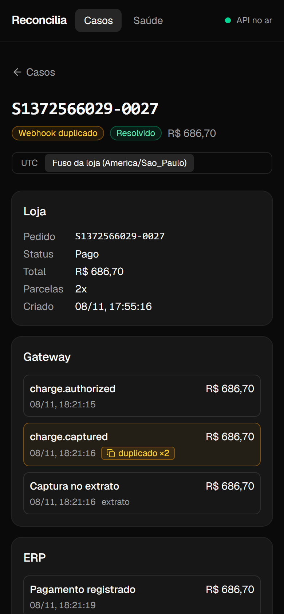
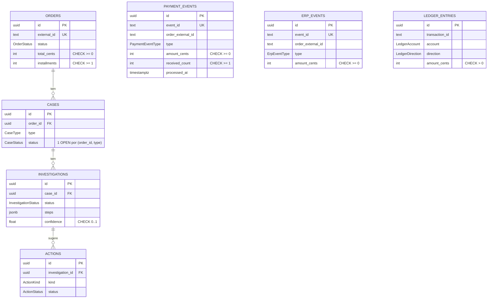

<div align="center">

# Reconcilia

**Encontra pagamentos que não batem entre loja, gateway e ERP, e um agente de IA investiga
cada caso. A IA sugere; uma pessoa aprova.**

Demo ao vivo (em construção) · Vídeo de 1 min (em construção) · Documentação da API (em construção)

[](https://github.com/devBandeiraa/reconcilia/actions/workflows/ci.yml)
[](https://github.com/devBandeiraa/reconcilia/releases)
[](LICENSE)
[](tsconfig.base.json)



</div>

> **Status:** v0.9.0. Backend e interface completos: simulador, ingestão idempotente, ledger,
> conciliação, agente de IA, aprovação humana com auditoria e as telas em Next.js. Falta o
> deploy (fase 10); veja o [roadmap](#roadmap).

## O problema

Uma venda passa por três sistemas que não conversam bem: a **loja** cria o pedido, o **gateway**
captura o pagamento e avisa por webhook, e o **ERP** registra o valor para o financeiro. Três
falhas aparecem sempre: o webhook de captura que **se perde** (cliente pagou, pedido segue
pendente), o webhook que chega **duplicado** (risco de baixar o pagamento duas vezes) e o
**valor divergente** entre gateway e ERP (juros de parcelamento, por exemplo). Na Backlgrs eram
mais de 15 incidentes por semana em 5 lojas, investigados um a um, na mão.

## Como funciona



O simulador gera tráfego com falhas conhecidas e a api aplica cada evento exatamente uma vez. A
conciliação abre casos, o agente investiga com ferramentas só de leitura e sugere uma ação, que
só é executada depois que uma pessoa aprova.

## Destaques técnicos

- **Tipos compartilhados entre front e back.** A api valida a resposta do `/health` com
  `HealthResponseSchema` e a web consome o mesmo schema. Prova:
  [`packages/shared/src/health.ts`](packages/shared/src/health.ts),
  [`apps/api/test/health.test.ts`](apps/api/test/health.test.ts).
- **Env validado na inicialização.** A api e a web não sobem com env inválido. Prova:
  [`apps/api/test/env.test.ts`](apps/api/test/env.test.ts).
- **OpenAPI gerado do Zod**, sem duplicar o tipo em DTOs de classe. Prova:
  [`apps/api/src/common/openapi.ts`](apps/api/src/common/openapi.ts).
- **Garantias no banco, não só no código.** `event_id` único, um só caso aberto por pedido e
  tipo (índice único parcial) e CHECKs de valor (o ledger não aceita lançamento de 0 ou
  negativo). Prova: [`apps/api/test/db/guarantees.test.ts`](apps/api/test/db/guarantees.test.ts),
  [migration](apps/api/prisma/migrations), [ADR 0002](docs/adr/0002-garantias-no-banco.md).
- **Simulador determinístico com gabarito.** A mesma seed gera o mesmo cenário (pedidos, falhas
  e valores) e o gabarito dos casos que a conciliação deve abrir. Prova:
  [`apps/simulator/test/scenario.test.ts`](apps/simulator/test/scenario.test.ts),
  [`apps/api/test/simulate.test.ts`](apps/api/test/simulate.test.ts).
- **Idempotência garantida no banco.** O mesmo webhook 50 vezes em paralelo vira 1 linha,
  1 job e 1 aplicação. O evento é gravado e enfileirado na mesma transação, e o worker só aplica
  se ainda não aplicou. Prova: [`apps/api/test/ingestion.test.ts`](apps/api/test/ingestion.test.ts),
  [seção Idempotência](#idempotência), [ADR 0004](docs/adr/0004-fila-no-postgres.md).
- **Ledger em partidas dobradas que sempre fecha em zero, garantido pelo banco.** Um trigger
  confere no COMMIT que cada transação soma zero, o ledger é append-only e o `transactionId`
  derivado do evento impede lançamento em dobro. Prova:
  [`apps/api/test/ledger.test.ts`](apps/api/test/ledger.test.ts), [seção Ledger](#ledger),
  [ADR 0005](docs/adr/0005-ledger-partidas-dobradas.md).
- **Conciliação validada contra o gabarito do simulador.** Com a seed fixa, os casos abertos são
  exatamente os do gabarito, mesmo conciliando antes de o worker terminar. Rodar de novo não abre
  nada (índice único parcial). Prova:
  [`apps/api/test/reconciliation.test.ts`](apps/api/test/reconciliation.test.ts),
  [seção Conciliação](#conciliação), [ADR 0006](docs/adr/0006-conciliacao.md).
- **Agente de IA só de leitura, com limites claros.**
  - As ferramentas rodam em transação `READ ONLY` (o Postgres recusa escrita).
  - O pedido vem do caso, nunca do modelo.
  - São no máximo 8 rodadas.
  - A saída é validada por schema e conferida contra os dados: um id inventado é recusado.
  - Testado sem o modelo real e validado com o Gemini.

  Prova: [`apps/api/test/agent.test.ts`](apps/api/test/agent.test.ts),
  [seção Agente de IA](#agente-de-ia), [ADR 0007](docs/adr/0007-agente-somente-leitura.md).

- **Aprovação humana com execução idempotente e trilha de auditoria.** A IA só sugere; uma
  pessoa aprova; o backend executa **uma única vez**, mesmo com duas aprovações ao mesmo tempo.
  Tudo vai para uma trilha de auditoria append-only. Prova:
  [`apps/api/test/actions.test.ts`](apps/api/test/actions.test.ts),
  [seção Aprovação humana](#aprovação-humana), [ADR 0008](docs/adr/0008-aprovacao-e-auditoria.md).

## Stack

| Camada       | Escolha                              | Por quê                                                                                        | Limite do plano gratuito     |
| ------------ | ------------------------------------ | ---------------------------------------------------------------------------------------------- | ---------------------------- |
| Monorepo     | pnpm workspaces                      | Tipos compartilhados sem publicar pacote ([ADR 0001](docs/adr/0001-monorepo-pnpm.md))          | Sem custo                    |
| API e worker | NestJS 12 + pino + Swagger           | DI e módulos claros; o worker roda no mesmo processo                                           | Render Free (em construção)  |
| Web          | Next.js 16 (App Router) + Tailwind 4 | Renderização no servidor, deploy simples                                                       | Vercel Hobby (em construção) |
| Contratos    | Zod 4                                | Um schema gera o tipo, a validação e o OpenAPI                                                 | Sem custo                    |
| Banco        | PostgreSQL 17 + Prisma 7             | Garantias no banco ([ADR 0002](docs/adr/0002-garantias-no-banco.md)); fila no próprio Postgres | Neon (em construção)         |
| Testes       | Vitest + Supertest                   | Rápidos, com banco real via Docker Compose                                                     | Sem custo                    |
| IA           | Gemini (`@google/genai`)             | Plano gratuito, atrás da interface `LlmClient`                                                 | Cota baixa; modo demo padrão |

## Rodando localmente

Pré-requisitos: Node 24 (veja [`.nvmrc`](.nvmrc)), Docker e pnpm 12. Para habilitar o pnpm:

```bash
corepack enable pnpm
```

Depois:

```bash
docker compose up -d
pnpm install
pnpm db:reset
pnpm dev
```

`pnpm db:reset` apaga o banco local, aplica todas as migrations do zero e roda o seed (3
pedidos: um pago, um pendente e um cancelado). Para só aplicar migrations novas sem apagar
nada, use `pnpm --filter @reconcilia/api db:migrate`.

| Serviço  | Endereço                                                |
| -------- | ------------------------------------------------------- |
| Web      | http://localhost:3000                                   |
| API      | http://localhost:3001/health                            |
| Swagger  | http://localhost:3001/docs                              |
| Postgres | `localhost:5440` (usuário, senha e banco: `reconcilia`) |

As variáveis de ambiente têm padrão para desenvolvimento local. Para mudar, copie
[`apps/api/.env.example`](apps/api/.env.example) para `apps/api/.env` e
[`apps/web/.env.example`](apps/web/.env.example) para `apps/web/.env.local`. A web chama a api
direto do navegador: `NEXT_PUBLIC_API_URL` (web) aponta para a api, e `CORS_ORIGIN` (api) precisa
listar a origem da web ([ADR 0009](docs/adr/0009-web-chama-a-api-direto.md)).

O agente de IA roda por padrão em **modo demonstração** (`DEMO_REPLAY=true`): sem chave, sem
custo e sem chamar o Gemini. Para usar o Gemini de verdade, crie uma chave gratuita no Google AI
Studio (não exige cartão) e, no `apps/api/.env`, defina `DEMO_REPLAY=false` e
`GEMINI_API_KEY=...`.

## Simulador

Gera tráfego de loja, gateway e ERP com as três falhas e imprime o **gabarito**: quais pedidos
devem virar qual caso na conciliação. Com a api no ar (`pnpm dev`):

```bash
pnpm --filter simulator start --orders 20 --seed 1
```

```
GABARITO · seed 1 · 20 pedidos
PAYMENT_WITHOUT_ORDER (1): S1-0006
DUPLICATE_WEBHOOK     (6): S1-0004 ×2, S1-0010 ×3, S1-0011 ×4, S1-0013 ×5, S1-0016 ×2, S1-0018 ×4
AMOUNT_MISMATCH       (3): S1-0007 (pedido 59840, ERP 77732), S1-0012 (pedido 58470, ERP 61967), S1-0014 (pedido 72380, ERP 76708)
sem falha             (10)

Enviado para http://localhost:3001: 20 pedidos, 20 autorizações, 19 capturas (+14 cópias duplicadas), 20 eventos do ERP, 20 linhas no extrato.
```

| Parâmetro     | Padrão    | O que faz                                                            |
| ------------- | --------- | -------------------------------------------------------------------- |
| `--orders`    | 50        | Pedidos gerados (1 a 200)                                            |
| `--lost`      | 0.1       | Fração com o webhook de captura **perdido**                          |
| `--duplicate` | 0.15      | Fração com o webhook de captura **duplicado** (2 a 5 cópias)         |
| `--mismatch`  | 0.1       | Fração com **valor divergente** no ERP (juros de 2,99% por parcela)  |
| `--seed`      | aleatória | Mesma seed, mesmo cenário. `--orders 20` é o começo de `--orders 50` |
| `--json`      | —         | Resultado em JSON                                                    |
| `--dry-run`   | —         | Só gera e imprime o gabarito, sem enviar nada                        |

Cada pedido tem no máximo uma falha, então `lost + duplicate + mismatch` precisa ser no máximo

1. Variáveis: `API_URL` (padrão `http://localhost:3001`) e `WEBHOOK_SECRET`.

Por pedido, o simulador envia, nesta ordem e assinando cada corpo com HMAC-SHA256 no header
`X-Signature`:

1. **Loja:** `order.created` para `POST /webhooks/store`.
2. **Gateway:** `charge.authorized` e `charge.captured` para `POST /webhooks/gateway`.
3. **ERP:** `payment.recorded` para `POST /webhooks/erp`.

No fim, ele publica o **extrato do gateway** em `POST /sim/gateway/statement`.

| Falha       | O que acontece                                                           | Caso esperado           |
| ----------- | ------------------------------------------------------------------------ | ----------------------- |
| `lost`      | O gateway captura, mas o `charge.captured` nunca chega; só o extrato tem | `PAYMENT_WITHOUT_ORDER` |
| `duplicate` | O mesmo `charge.captured` chega de 2 a 5 vezes, parte em paralelo        | `DUPLICATE_WEBHOOK`     |
| `mismatch`  | O ERP registra o total com juros de parcelamento                         | `AMOUNT_MISMATCH`       |

O mesmo gerador roda pela api em `POST /simulate` (o botão "Gerar falhas" da interface), que
devolve a seed e o gabarito. Os IDs vêm da seed (`S1-0001`), então rodar a mesma seed de novo é
um reenvio idempotente, não dados novos.

## Idempotência

Cada evento do gateway é aplicado **exatamente uma vez**, mesmo com cópias simultâneas, retries
e quedas no meio do caminho. Quem garante isso é o banco: a fila e o código são otimização.



| Camada         | Mecanismo                                                                    | O que impede                                                          |
| -------------- | ---------------------------------------------------------------------------- | --------------------------------------------------------------------- |
| Ingestão       | `UNIQUE (event_id)` + `INSERT ... ON CONFLICT DO UPDATE` num único statement | Duas linhas para o mesmo evento, mesmo com 50 cópias em paralelo      |
| Enfileiramento | Job criado dentro da transação do INSERT (`fromPrisma` do pg-boss)           | Evento gravado sem job (ou job sem evento) se o processo cair no meio |
| Fila           | Policy `exclusive` + `singletonKey = eventId`                                | Dois jobs vivos para o mesmo evento                                   |
| Aplicação      | `UPDATE ... WHERE processed_at IS NULL` na transação que aplica              | Aplicar duas vezes, mesmo com retry ou dois workers                   |

Falhas na aplicação (o pedido ainda não chegou, o banco caiu) desfazem a transação inteira,
inclusive o `processed_at`. O pg-boss tenta de novo com backoff exponencial (`QUEUE_RETRY_LIMIT`,
padrão 5). Quando as tentativas acabam, o evento vai para a dead letter queue, consultável em
`GET /admin/dlq`.

Os testes que provam isso, contra um PostgreSQL real, estão em
[`apps/api/test/ingestion.test.ts`](apps/api/test/ingestion.test.ts):

- **O mesmo webhook 50 vezes em paralelo:** 1 linha com `received_count = 50`, um `202` e 49
  respostas `200`, 1 job, 1 aplicação e o pedido `PAID`.
- **Assinatura inválida, corpo alterado ou ausente:** `401`, nada gravado e nada enfileirado.
- **Ledger que falha 2 vezes e depois funciona:** aplicado uma vez só.
- **Pedido que nunca chega:** as tentativas se esgotam e o evento aparece em `/admin/dlq`.

Com a api no ar, o simulador com metade dos pedidos duplicados (`--orders 100 --seed 4242
--duplicate 0.5`) enviou 91 capturas e mais 115 cópias. No banco ficaram 91 eventos, cada um
aplicado uma vez, 91 pedidos `PAID`, e os 9 `PENDING` são exatamente os pedidos perdidos do
gabarito.

## Ledger

Todo movimento de dinheiro vira uma transação em partidas dobradas: um cabeçalho
(`ledger_transactions`) e pelo menos dois lançamentos (`ledger_entries`). Os lançamentos são
sempre positivos, e a direção (débito ou crédito) dá o sinal.

| Movimento                   | Débito               | Crédito              | `transactionId`     |
| --------------------------- | -------------------- | -------------------- | ------------------- |
| Captura (`charge.captured`) | `GATEWAY_RECEIVABLE` | `ORDER_REVENUE`      | `capture:<eventId>` |
| Estorno (`charge.refunded`) | `REFUNDS`            | `GATEWAY_RECEIVABLE` | `refund:<eventId>`  |

- **`GATEWAY_RECEIVABLE`:** o que o gateway nos deve.
- **`ORDER_REVENUE`:** a receita dos pedidos.
- **`REFUNDS`:** conta redutora da receita.
- **`ERP_ADJUSTMENTS`:** fica reservada para os ajustes da fase 8.

O worker lança no ledger **dentro da mesma transação** que marca o evento como aplicado: se o
ledger falhar, nada é aplicado e o job é tentado de novo.

| Garantia                           | Quem garante                                                                                              |
| ---------------------------------- | --------------------------------------------------------------------------------------------------------- |
| Débitos = créditos, 2+ lançamentos | `LedgerService.post` valida antes de gravar; um trigger `DEFERRABLE INITIALLY DEFERRED` confere no COMMIT |
| Valor positivo                     | `CHECK (amount_cents > 0)`                                                                                |
| Sem lançamento em dobro            | `transaction_id` é PK de `ledger_transactions`, e o id vem do evento                                      |
| Histórico imutável                 | Triggers recusam UPDATE e DELETE: correção é um lançamento de estorno                                     |

```bash
curl localhost:3001/ledger/balance
```

Esse endpoint devolve débitos, créditos e saldo (débitos - créditos) de cada conta, e o total,
que precisa ser **sempre 0**. Com a api no ar, o simulador com 100 pedidos e 30% de duplicados
(`--seed 5005 --duplicate 0.3`) gerou 90 capturas e mais 65 cópias. O resultado foi:

```
GATEWAY_RECEIVABLE   D   4324570 C         0 saldo    4324570
ORDER_REVENUE        D         0 C   4324570 saldo   -4324570
REFUNDS              D         0 C         0 saldo          0
ERP_ADJUSTMENTS      D         0 C         0 saldo          0
totalCents = 0 | transações 90 | lançamentos 180
```

O a receber (R$ 43.245,70) é exatamente a soma das 90 capturas aplicadas.

## Conciliação

A conciliação compara, pedido a pedido, a **loja** (`orders`), o **gateway** (o extrato e os
webhooks recebidos) e o **ERP**, e abre um caso para cada divergência:

| Tipo                    | Quando abre                                                                                                | Falha do simulador |
| ----------------------- | ---------------------------------------------------------------------------------------------------------- | ------------------ |
| `PAYMENT_WITHOUT_ORDER` | O extrato do gateway tem a captura, o pedido está `PENDING` e nenhum `charge.captured` desse pedido chegou | `lost`             |
| `DUPLICATE_WEBHOOK`     | Algum evento do gateway do pedido chegou mais de uma vez (`received_count > 1`)                            | `duplicate`        |
| `AMOUNT_MISMATCH`       | Valor capturado (extrato), total do pedido e valor do ERP não são os três iguais                           | `mismatch`         |

- **Por que "nenhum `charge.captured` chegou":** uma captura que chegou mas ainda está na fila do
  worker não é "pagamento sem pedido". Com isso, o resultado não depende do tempo do worker.
- **Um caso aberto por pedido e tipo:** quem garante é o índice único parcial da fase 2. Abrir é um
  `INSERT ... ON CONFLICT DO NOTHING`, então rodar de novo não duplica nem dá erro.
- **Quando roda:** a cada 5 minutos, por um job agendado no pg-boss (`RECONCILIATION_CRON`, cron em
  UTC), ou na hora, com `POST /reconcile`.

```bash
curl -X POST localhost:3001/reconcile
curl "localhost:3001/cases?type=AMOUNT_MISMATCH&status=OPEN&limit=20"
curl localhost:3001/cases/<id>
```

- **`GET /cases`:** lista com filtros por tipo e status, mais recentes primeiro, com paginação.
- **`GET /cases/:id`:** traz o pedido e a **linha do tempo dos três lados** (loja, webhooks do
  gateway com `receivedCount` e duplicado destacado, extrato e ERP) em ordem cronológica e em UTC,
  além do histórico do caso.

Com a api no ar, duas rodadas seguidas sobre o banco de desenvolvimento, com todas as simulações
das fases anteriores, deram este resultado:

```
1ª: {"opened":{"PAYMENT_WITHOUT_ORDER":38,"DUPLICATE_WEBHOOK":132,"AMOUNT_MISMATCH":42},"alreadyOpen":0}
2ª: {"opened":{"PAYMENT_WITHOUT_ORDER":0,"DUPLICATE_WEBHOOK":0,"AMOUNT_MISMATCH":0},"alreadyOpen":212}
seed 5005: gabarito 47 linhas, casos abertos 47 → idênticos
```

## Agente de IA

Cada caso pode ser investigado por um agente que **lê** os dados dos três lados e **recomenda**
uma ação. Ele não executa nada: a ação fica `PENDING` até uma pessoa aprovar (veja
[Aprovação humana](#aprovação-humana)).

```bash
curl -X POST localhost:3001/cases/<id>/investigate   # 202 {investigationId, status: QUEUED}
curl localhost:3001/investigations/<investigationId> # polling: passos, diagnóstico, ação
```

| Ferramenta            | O que lê (sempre do pedido do caso)                                                      |
| --------------------- | ---------------------------------------------------------------------------------------- |
| `getOrder`            | Status, total, parcelas e criação (UTC e fuso da loja)                                   |
| `getGatewayEvents`    | Webhooks do gateway: tipo, valor, `receivedCount`, quando ocorreu, chegou e foi aplicado |
| `getGatewayStatement` | Extrato do gateway: as capturas, inclusive as cujo webhook se perdeu                     |
| `getErpEvents`        | Lançamentos do ERP: tipo, valor e quando foram registrados                               |
| `submitDiagnosis`     | Saída final: diagnóstico, evidências, ação sugerida e confiança (0 a 1)                  |

As ações que ele pode sugerir são `MARK_ORDER_PAID` (`chargeId`), `REPROCESS_WEBHOOK` (`eventId`),
`IGNORE_DUPLICATE` (`eventId`) e `FLAG_ERP_DIVERGENCE` (`expectedCents`, `erpCents`). O prompt de
sistema é versionado em [`prompts/system.v1.md`](apps/api/src/agent/prompts/system.v1.md).

**Limites:**

- **Só leitura, garantido pelo banco:** cada ferramenta roda numa transação `READ ONLY`, então o
  Postgres recusa qualquer escrita. Quem grava a investigação e a ação é o backend, depois.
- **O pedido vem do caso:** as ferramentas não têm argumentos e a ação não tem `orderId`.
- **No máximo 8 chamadas ao modelo:** se passar disso, a investigação fica `FAILED`.
- **Saída validada e conferida:** o `submitDiagnosis` passa por Zod e pela conferência contra os
  dados. O `chargeId` e o `eventId` precisam ser do pedido, e os valores precisam bater com o
  extrato e o ERP. Um diagnóstico inválido volta para o modelo **uma vez**; na segunda, a
  investigação fica `FAILED`.
- **Cota esgotada (429):** a investigação fica `FAILED` na hora, com o motivo, e o worker segue.
  Erros transitórios (5xx) têm até 3 tentativas curtas.
- **Uma investigação ativa por caso:** quem garante é um índice único parcial. Se a api reiniciar
  no meio de uma, ela vira `FAILED` na subida.

**Modo demonstração (`DEMO_REPLAY=true`, o padrão):** o agente segue roteiros por tipo de caso
([`replay.v1.json`](apps/api/src/agent/fixtures/replay.v1.json)) sem chamar o Gemini. As
ferramentas rodam de verdade e o diagnóstico é preenchido com os dados delas, então ele passa pela
mesma validação.

**Exemplo real, com o Gemini (`gemini-3.5-flash`).** O caso era do tipo `DUPLICATE_WEBHOOK`, e o
agente usou 2 rodadas e 9 segundos:

```
passos:  1: getOrder → pedido S5005-0002 PAID, total 83640
         1: getGatewayEvents → 2 webhooks (AUTHORIZED, CAPTURED); 1 com reenvio
         1: getGatewayStatement → 1 captura(s) no extrato, soma 83640
         1: getErpEvents → 1 lançamento(s) no ERP; pagamentos somam 83640
         2: submitDiagnosis → diagnóstico aceito: IGNORE_DUPLICATE
ação:    IGNORE_DUPLICATE { eventId: "evt_S5005-0002_captured" }   confiança 1
diagnóstico: O webhook de captura (evt_S5005-0002_captured) foi recebido 5 vezes pelo sistema
  da loja, porém foi processado e aplicado com sucesso apenas uma vez. O pedido já se encontra
  com status PAID, o extrato do gateway confirma a captura de 83640 centavos (ch_S5005-0002) e o
  ERP registrou o pagamento corretamente no mesmo valor. [...] a ação recomendada é ignorar o
  evento duplicado.
evidências:
  - webhook gateway: evt_S5005-0002_captured (CAPTURED, 83640 centavos) teve receivedCount = 5 e
    foi processado uma vez em 2026-11-08T17:07:12.365Z
  - extrato gateway: chargeId ch_S5005-0002 capturado no valor de 83640 centavos em
    2026-11-08T17:08:12.770Z
  - erp: lançamento erp_S5005-0002_payment (PAYMENT_RECORDED) no valor de 83640 centavos
```

Os outros dois tipos também terminaram certos com o Gemini:

- `PAYMENT_WITHOUT_ORDER` → `MARK_ORDER_PAID`, em 23s.
- `AMOUNT_MISMATCH` → `FLAG_ERP_DIVERGENCE` (20960 contra 22213), em 42s.

## Aprovação humana

A ação sugerida pelo agente só é executada depois que uma pessoa aprova. Quem executa é o
backend, nunca o modelo.

```bash
curl -X POST localhost:3001/actions/<id>/approve -H 'content-type: application/json' \
  -d '{"decidedBy": "Ana"}'
curl -X POST localhost:3001/actions/<id>/reject -H 'content-type: application/json' \
  -d '{"decidedBy": "Ana", "reason": "quero conferir com o gateway"}'
curl localhost:3001/actions/<id>   # decisão, resultado da execução e trilha de auditoria
```

| Ação                  | O que o backend executa ao aprovar                                                                             |
| --------------------- | -------------------------------------------------------------------------------------------------------------- |
| `MARK_ORDER_PAID`     | Pedido `PENDING → PAID` e captura no ledger com `capture:<eventId do extrato>`, o mesmo id que o worker usaria |
| `REPROCESS_WEBHOOK`   | Reenfileira o evento original se ele ainda não foi aplicado (o worker aplica uma vez)                          |
| `FLAG_ERP_DIVERGENCE` | Pede o ajuste ao ERP (aqui, o ERP simulado), uma vez por ação                                                  |
| `IGNORE_DUPLICATE`    | Só encerra o caso                                                                                              |

O pedido sempre sai do caso, nunca dos `params`. Executada a ação, o caso fica `RESOLVED`. Se
for recusada, o caso continua `OPEN` e pode ser investigado de novo.

**Execução exatamente uma vez:**

1. **Aprovar:** é um `UPDATE actions SET status = 'APPROVED' ... WHERE status = 'PENDING'`
   condicional.
2. **Executar:** acontece numa transação que começa com
   `UPDATE actions SET status = 'EXECUTED' WHERE id = $1 AND status = 'APPROVED'`. Com 0 linhas,
   outra chamada já executou, e esta sai sem efeito. O efeito, o caso `RESOLVED` e a linha da
   auditoria entram no **mesmo COMMIT**.
3. **Se o efeito falhar:** por exemplo, se o `chargeId` saiu do extrato, a transação volta. Nada é
   gravado, a ação segue `APPROVED`, a falha vai para a auditoria e a resposta é **422**. Aprovar
   de novo tenta outra vez.
4. **Webhook atrasado:** o `MARK_ORDER_PAID` usa o mesmo `transactionId` do worker. Se o webhook
   perdido chegar depois, o ledger devolve `already-posted`, e não há lançamento em dobro.

**Trilha de auditoria (`audit_log`):** registra `APPROVED`, `REJECTED`, `EXECUTED` e
`EXECUTION_FAILED`, com quem, quando e os detalhes. Um trigger torna a tabela **append-only**, e
o histórico do `GET /cases/:id` mostra tudo. A conciliação **não reabre** um caso que uma pessoa
resolveu ou descartou.

Com a api no ar, aprovei as três ações que o Gemini real tinha sugerido:

```
FLAG_ERP_DIVERGENCE (S5005-0009) → EXECUTED, caso RESOLVED, ajuste de 1253 pedido ao ERP
MARK_ORDER_PAID     (S5005-0006) → EXECUTED, caso RESOLVED, pedido PENDING → PAID, ledger posted
IGNORE_DUPLICATE    (S5005-0002) → EXECUTED, caso RESOLVED
ledger: total 0 | conciliação seguinte: 0 abertos, alreadyResolved 2

Histórico do caso S5005-0006:
  DETECTED       Detectado pela conciliação
  INVESTIGATION  Investigação do agente DONE: sugeriu MARK_ORDER_PAID
  APPROVED       Jhordan Bandeira aprovou MARK_ORDER_PAID
  EXECUTED       backend executou MARK_ORDER_PAID (aprovada por Jhordan Bandeira)
  RESOLVED       Resolvido
```

## Interface

Abra http://localhost:3000 com `pnpm dev` rodando. O caminho da demo cabe em um minuto:

1. **Casos:** "Gerar falhas" manda 30 pedidos com problemas pelo simulador, e "Conciliar agora"
   abre os casos. Os contadores por tipo filtram a lista.
2. **Caso:** loja, gateway (com o extrato) e ERP lado a lado, e a linha do tempo com os
   duplicados em âmbar. Os horários alternam entre UTC e o fuso da loja.
3. **Agente:** "Investigar" mostra os passos enquanto o agente consulta os três lados, depois o
   diagnóstico, as evidências, a confiança e a ação sugerida.
4. **Decisão:** com o seu nome, "Aprovar" faz o backend executar e o caso fica resolvido;
   "Recusar" pede um motivo e mantém o caso aberto.
5. **Saúde:** saldo do ledger por conta (o total é zero), fila de mortos e status da api.

| Casos                                          | Caso, agente e aprovação                      |
| ---------------------------------------------- | --------------------------------------------- |
|           |          |
| **Saúde**                                      | **No celular**                                |
|  |  |

Toda resposta da api é validada com os schemas de `packages/shared`. Se a api demora mais de 3
segundos (no plano gratuito ela dorme), a tela avisa "Acordando o servidor…" e tenta de novo
sozinha por até 90 segundos. Os campos têm rótulo, o foco é visível, as mensagens de resultado
são lidas pelo leitor de tela e a cor nunca é a única pista: todo selo tem texto.

## Testes

```bash
pnpm lint && pnpm typecheck && pnpm test
```

São 92 testes hoje. Os 76 da api rodam contra um PostgreSQL real, e **nenhum chama o modelo
real**: o `LlmClient` é trocado por roteiros (`FakeLlmClient`).

- **Aprovação humana (13):**
  - **Aprovar duas vezes em paralelo executa uma vez só:** um `APPROVED` e um `EXECUTED` na
    auditoria, e 2 lançamentos no ledger, não 4.
  - **Recusar não altera pedido nem ledger:** comparado por md5.
  - **O efeito de cada ação:** inclusive o webhook perdido que chega depois sem lançar em dobro.
  - **A conciliação não reabre casos resolvidos.**
  - **Erros:** 422 sem mudar nada, além de 404 e 400.
  - **Auditoria:** append-only, e o ledger segue somando zero.

- **Agente (16):**
  - Cada tipo de caso termina `DONE` com a ação esperada.
  - Passar de 8 rodadas termina `FAILED`.
  - Um id inventado é recusado e o diagnóstico corrigido é aceito.
  - Um diagnóstico inválido duas vezes termina `FAILED`.
  - O 429 termina `FAILED`, e o worker segue funcionando.
  - **O banco fica idêntico (md5 de todas as tabelas) antes e depois das ferramentas**, e uma
    escrita dentro da transação delas é recusada.
  - Os endpoints devolvem 200, 409, 404 e 400.
  - Uma investigação interrompida é liberada.
  - O modo demonstração funciona ponta a ponta.

- **Conciliação (7):**
  - Com a seed fixa, os casos abertos são exatamente os do gabarito (22 casos dos 3 tipos na
    seed 42).
  - Rodar duas vezes não cria casos novos.
  - Conciliar sem esperar a fila dá o mesmo resultado.
  - `GET /cases` com filtros e paginação.
  - `GET /cases/:id` com a linha do tempo ordenada e o duplicado destacado, mais os erros 404 e 400.
  - O job agendado fica registrado.
- **Ledger (10):**
  - Transação desbalanceada, com um só lançamento ou com valor 0 dá erro e não grava nada.
  - O mesmo `transactionId` postado de novo não duplica.
  - Por fora do serviço, em SQL puro, um INSERT desbalanceado falha no COMMIT, e UPDATE e
    DELETE são recusados.
  - Captura e estorno lançados pelo worker deixam o total em 0.
  - Reprocessar um evento não duplica lançamentos.
  - Depois do simulador completo, o total é 0.
- **Ingestão idempotente (7):** 50 webhooks iguais em paralelo, assinatura inválida ou ausente,
  retry depois de 2 falhas, dead letter queue e duplicados do ERP e da loja.
- **Garantias do banco (4):** `eventId` duplicado, dois casos abertos iguais (e o índice
  parcial deixando passar quando o anterior foi resolvido) e lançamento de ledger com valor 0.
- **Webhooks e extrato (6):** evento traduzido para o modelo interno, reenvio com 200, 400
  com a lista de problemas, extrato com filtro e paginação.
- **`POST /simulate` ponta a ponta (5):** o banco bate com o gabarito e a mesma seed de novo
  não grava nada novo.
- **API (2):** o contrato do `/health` e o OpenAPI publicado em `/docs`.
- **Env (4):** padrões, erro legível, `DATABASE_URL` que não é Postgres e `WEBHOOK_SECRET` em
  produção.

Os testes de fila esperam retries reais (alguns segundos cada). Para isso, rodam com
`QUEUE_RETRY_LIMIT=2`, `QUEUE_RETRY_DELAY_SECONDS=1` e polling de 0,5s.

Os 16 do simulador cobrem o determinismo (mesma seed, mesmo cenário), o efeito de cada falha,
o gabarito, os contratos dos payloads, a ordem dos envios e a assinatura HMAC.

Os testes usam um banco separado, `reconcilia_test`, que o Vitest cria e migra sozinho, então
eles nunca apagam o banco de desenvolvimento. Para apontar para outro banco, use
`TEST_DATABASE_URL`.

## Arquitetura e decisões

```
apps/
  api/         NestJS: HTTP, worker (pg-boss) e agente
  web/         Next.js: telas de casos, diagnóstico e saúde
  simulator/   gerador de tráfego da loja, gateway e ERP
packages/
  shared/      schemas Zod e tipos (única fonte de DTOs)
docs/adr/      decisões de arquitetura
```

### Modelo de dados



Os eventos do gateway e do ERP ficam ligados ao pedido por `order_external_id`, sem FK: o evento
bruto é gravado mesmo que o pedido ainda não exista, e é a conciliação que aponta a divergência.
Dinheiro sempre em centavos (`int`) e datas sempre em UTC (`timestamptz`).

A tabela `sim_gateway_statement` guarda o extrato do gateway **simulado**. Ela representa um
sistema externo e não faz parte do modelo do Reconcilia.

- [ADR 0001: monorepo com pnpm workspaces](docs/adr/0001-monorepo-pnpm.md)
- [ADR 0002: garantias no banco](docs/adr/0002-garantias-no-banco.md)
- [ADR 0003: simulador e sistemas externos](docs/adr/0003-simulador-e-sistemas-externos.md)
- [ADR 0004: fila no Postgres](docs/adr/0004-fila-no-postgres.md)
- [ADR 0005: ledger em partidas dobradas](docs/adr/0005-ledger-partidas-dobradas.md)
- [ADR 0006: conciliação](docs/adr/0006-conciliacao.md)
- [ADR 0007: agente somente leitura](docs/adr/0007-agente-somente-leitura.md)
- [ADR 0008: aprovação e auditoria](docs/adr/0008-aprovacao-e-auditoria.md)
- [ADR 0009: a web chama a api direto](docs/adr/0009-web-chama-a-api-direto.md)

## Limitações conhecidas

- Não há login: quem aprova ou recusa se identifica no corpo da requisição (`decidedBy`). A
  trilha de auditoria registra o nome informado, não uma identidade verificada.
- O ajuste de divergência vai para um ERP simulado (`sim_erp_adjustments`). Num ERP real, seria a
  API dele, com o `actionId` como chave de idempotência.
- O plano gratuito do Gemini tem cota baixa e instabilidade. No aceite, o `gemini-3.8-flash`
  respondeu 503 e 504, e a cota por minuto acabou depois de poucas investigações. Por isso o
  padrão é o modo demonstração e o modelo padrão é o `gemini-3.5-flash`, que foi o que respondeu
  de forma estável.
- Os roteiros do modo demonstração foram escritos à mão, no formato de uma investigação real.
- O ledger registra só o lado do gateway (captura e estorno). Liquidação (o dinheiro saindo do
  gateway para a conta da loja), taxas e os ajustes do ERP ficam fora por enquanto.
- Pedidos marcados como pagos antes da v0.5.0 não têm lançamento: o ledger começou a registrar
  nesta versão. Num banco novo (`pnpm db:reset`), tudo passa pelo ledger.
- A assinatura dos webhooks não tem proteção contra replay (timestamp no header): um corpo
  assinado capturado poderia ser reenviado. Reenviar é inofensivo aqui, porque a ingestão é
  idempotente, mas um gateway real deveria mandar um timestamp assinado.
- `GET /admin/dlq` não tem autenticação; a proteção da demo pública entra na fase 10.
- A interface não tem testes automatizados de tela; foi conferida no navegador (desktop e
  celular), com o fluxo completo de ponta a ponta.
- `NEXT_PUBLIC_API_URL` é embutida no build da web: trocar a api exige um novo build.
- O gateway, a loja e o ERP são simulados. O extrato do gateway mora numa tabela do próprio
  banco (`sim_gateway_statement`), no lugar da API de conciliação de um gateway real.
- O índice único parcial usa o preview feature `partialIndexes` do Prisma 7. Se ele mudar numa
  versão futura, o índice pode voltar a ser escrito em SQL na migration.
- O TypeScript está fixado na 6.0 porque `typescript-eslint` e `@nestjs/swagger` ainda não
  aceitam a 7.0.

## Roadmap

| Versão | Entrega                                      | Status |
| ------ | -------------------------------------------- | ------ |
| v0.1.0 | Monorepo, CI, README inicial                 | ✅     |
| v0.2.0 | Modelo de dados com garantias no banco       | ✅     |
| v0.3.0 | Gerador de tráfego e das 3 falhas            | ✅     |
| v0.4.0 | Webhooks idempotentes + fila                 | ✅     |
| v0.5.0 | Partidas dobradas                            | ✅     |
| v0.6.0 | Detecção de divergências                     | ✅     |
| v0.7.0 | Agente de IA investigador                    | ✅     |
| v0.8.0 | Aprovação humana e execução                  | ✅     |
| v0.9.0 | Telas em Next.js                             | ✅     |
| v1.0.0 | No ar + README final                         | 🚧     |
| v1.1.0 | RAG com casos parecidos e runbook (opcional) | 🚧     |

## Autor

Jhordan Bandeira · LinkedIn (em construção) · [GitHub](https://github.com/devBandeiraa)
