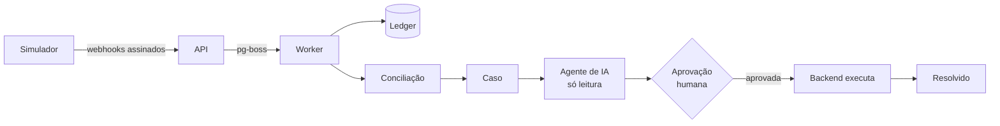

<div align="center">

# Reconcilia

**Encontra pagamentos que não batem entre loja, gateway e ERP, e um agente de IA investiga
cada caso. A IA sugere; uma pessoa aprova.**

Demo ao vivo (em construção) · Vídeo de 1 min (em construção) · Documentação da API (em construção)

[](https://github.com/devBandeiraa/reconcilia/actions/workflows/ci.yml)
[](https://github.com/devBandeiraa/reconcilia/releases)
[](LICENSE)
[](tsconfig.base.json)

<!-- GIF do fluxo completo: chega na fase 9 (docs/img/fluxo.gif) -->

</div>

> **Status:** v0.3.0. A base do monorepo, o modelo de dados com garantias no banco e o
> simulador das 3 falhas estão prontos. As seções marcadas como _em construção_ chegam nas
> próximas fases; veja o [roadmap](#roadmap).

## O problema

Uma venda passa por três sistemas que não conversam bem: a **loja** cria o pedido, o **gateway**
captura o pagamento e avisa por webhook, e o **ERP** registra o valor para o financeiro. Três
falhas aparecem sempre: o webhook de captura que **se perde** (cliente pagou, pedido segue
pendente), o webhook que chega **duplicado** (risco de baixar o pagamento duas vezes) e o
**valor divergente** entre gateway e ERP (juros de parcelamento, por exemplo). Na Backlgrs eram
mais de 15 incidentes por semana em 5 lojas, investigados um a um, na mão.

## Como funciona

_Em construção._ O fluxo planejado:



O simulador gera tráfego com falhas conhecidas e a api aplica cada evento exatamente uma vez. A
conciliação abre casos, o agente investiga com ferramentas só de leitura e sugere uma ação, que
só é executada depois que uma pessoa aprova.

## Destaques técnicos

- **Tipos compartilhados entre front e back.** A api valida a resposta do `/health` com
  `HealthResponseSchema` e a web consome o mesmo schema. Prova:
  [`packages/shared/src/health.ts`](packages/shared/src/health.ts),
  [`apps/api/test/health.test.ts`](apps/api/test/health.test.ts).
- **Env validado na inicialização.** A api e a web não sobem com env inválido. Prova:
  [`apps/api/test/env.test.ts`](apps/api/test/env.test.ts).
- **OpenAPI gerado do Zod**, sem duplicar o tipo em DTOs de classe. Prova:
  [`apps/api/src/common/openapi.ts`](apps/api/src/common/openapi.ts).
- **Garantias no banco, não só no código.** `event_id` único, um só caso aberto por pedido e
  tipo (índice único parcial) e CHECKs de valor (o ledger não aceita lançamento de 0 ou
  negativo). Prova: [`apps/api/test/db/guarantees.test.ts`](apps/api/test/db/guarantees.test.ts),
  [migration](apps/api/prisma/migrations), [ADR 0002](docs/adr/0002-garantias-no-banco.md).
- **Simulador determinístico com gabarito.** A mesma seed gera o mesmo cenário (pedidos, falhas
  e valores) e o gabarito dos casos que a conciliação deve abrir. Prova:
  [`apps/simulator/test/scenario.test.ts`](apps/simulator/test/scenario.test.ts),
  [`apps/api/test/simulate.test.ts`](apps/api/test/simulate.test.ts).
- Idempotência da ingestão de webhooks: _em construção (fase 4)_.
- Ledger em partidas dobradas que sempre fecha em zero: _em construção (fase 5)_.
- Conciliação validada contra o gabarito do simulador: _em construção (fase 6)_.
- Agente só de leitura, com no máximo 8 rodadas e saída validada por schema: _em construção
  (fase 7)_.
- Aprovação humana com execução idempotente e trilha de auditoria: _em construção (fase 8)_.

## Stack

| Camada       | Escolha                              | Por quê                                                                                        | Limite do plano gratuito     |
| ------------ | ------------------------------------ | ---------------------------------------------------------------------------------------------- | ---------------------------- |
| Monorepo     | pnpm workspaces                      | Tipos compartilhados sem publicar pacote ([ADR 0001](docs/adr/0001-monorepo-pnpm.md))          | Sem custo                    |
| API e worker | NestJS 12 + pino + Swagger           | DI e módulos claros; o worker roda no mesmo processo                                           | Render Free (em construção)  |
| Web          | Next.js 16 (App Router) + Tailwind 4 | Renderização no servidor, deploy simples                                                       | Vercel Hobby (em construção) |
| Contratos    | Zod 4                                | Um schema gera o tipo, a validação e o OpenAPI                                                 | Sem custo                    |
| Banco        | PostgreSQL 17 + Prisma 7             | Garantias no banco ([ADR 0002](docs/adr/0002-garantias-no-banco.md)); fila no próprio Postgres | Neon (em construção)         |
| Testes       | Vitest + Supertest                   | Rápidos, com banco real via Docker Compose                                                     | Sem custo                    |
| IA           | Gemini (`@google/genai`)             | Plano gratuito, atrás da interface `LlmClient`                                                 | Em construção (fase 7)       |

## Rodando localmente

Pré-requisitos: Node 24 (veja [`.nvmrc`](.nvmrc)), Docker e pnpm 12. Para habilitar o pnpm:

```bash
corepack enable pnpm
```

Depois:

```bash
docker compose up -d
pnpm install
pnpm db:reset
pnpm dev
```

`pnpm db:reset` apaga o banco local, aplica todas as migrations do zero e roda o seed (3
pedidos: um pago, um pendente e um cancelado). Para só aplicar migrations novas sem apagar
nada, use `pnpm --filter @reconcilia/api db:migrate`.

| Serviço  | Endereço                                                |
| -------- | ------------------------------------------------------- |
| Web      | http://localhost:3000                                   |
| API      | http://localhost:3001/health                            |
| Swagger  | http://localhost:3001/docs                              |
| Postgres | `localhost:5440` (usuário, senha e banco: `reconcilia`) |

As variáveis de ambiente têm padrão para desenvolvimento local. Para mudar, copie
[`apps/api/.env.example`](apps/api/.env.example) para `apps/api/.env` e
[`apps/web/.env.example`](apps/web/.env.example) para `apps/web/.env.local`.

## Simulador

Gera tráfego de loja, gateway e ERP com as três falhas e imprime o **gabarito**: quais pedidos
devem virar qual caso na conciliação. Com a api no ar (`pnpm dev`):

```bash
pnpm --filter simulator start --orders 20 --seed 1
```

```
GABARITO · seed 1 · 20 pedidos
PAYMENT_WITHOUT_ORDER (1): S1-0006
DUPLICATE_WEBHOOK     (6): S1-0004 ×2, S1-0010 ×3, S1-0011 ×4, S1-0013 ×5, S1-0016 ×2, S1-0018 ×4
AMOUNT_MISMATCH       (3): S1-0007 (pedido 59840, ERP 77732), S1-0012 (pedido 58470, ERP 61967), S1-0014 (pedido 72380, ERP 76708)
sem falha             (10)

Enviado para http://localhost:3001: 20 pedidos, 20 autorizações, 19 capturas (+14 cópias duplicadas), 20 eventos do ERP, 20 linhas no extrato.
```

| Parâmetro     | Padrão    | O que faz                                                            |
| ------------- | --------- | -------------------------------------------------------------------- |
| `--orders`    | 50        | Pedidos gerados (1 a 200)                                            |
| `--lost`      | 0.1       | Fração com o webhook de captura **perdido**                          |
| `--duplicate` | 0.15      | Fração com o webhook de captura **duplicado** (2 a 5 cópias)         |
| `--mismatch`  | 0.1       | Fração com **valor divergente** no ERP (juros de 2,99% por parcela)  |
| `--seed`      | aleatória | Mesma seed, mesmo cenário. `--orders 20` é o começo de `--orders 50` |
| `--json`      | —         | Resultado em JSON                                                    |
| `--dry-run`   | —         | Só gera e imprime o gabarito, sem enviar nada                        |

Cada pedido tem no máximo uma falha, então `lost + duplicate + mismatch` precisa ser no máximo

1. Variáveis: `API_URL` (padrão `http://localhost:3001`) e `WEBHOOK_SECRET`.

Por pedido, o simulador envia, nesta ordem e assinando cada corpo com HMAC-SHA256 no header
`X-Signature`:

1. **Loja:** `order.created` para `POST /webhooks/store`.
2. **Gateway:** `charge.authorized` e `charge.captured` para `POST /webhooks/gateway`.
3. **ERP:** `payment.recorded` para `POST /webhooks/erp`.

No fim, ele publica o **extrato do gateway** em `POST /sim/gateway/statement`.

| Falha       | O que acontece                                                           | Caso esperado           |
| ----------- | ------------------------------------------------------------------------ | ----------------------- |
| `lost`      | O gateway captura, mas o `charge.captured` nunca chega; só o extrato tem | `PAYMENT_WITHOUT_ORDER` |
| `duplicate` | O mesmo `charge.captured` chega de 2 a 5 vezes, parte em paralelo        | `DUPLICATE_WEBHOOK`     |
| `mismatch`  | O ERP registra o total com juros de parcelamento                         | `AMOUNT_MISMATCH`       |

O mesmo gerador roda pela api em `POST /simulate` (o botão "Gerar falhas" da interface), que
devolve a seed e o gabarito. Os IDs vêm da seed (`S1-0001`), então rodar a mesma seed de novo é
um reenvio idempotente, não dados novos.

## Testes

```bash
pnpm lint && pnpm typecheck && pnpm test
```

São 37 testes hoje. Os 21 da api rodam contra um PostgreSQL real:

- **Garantias do banco (4):** `eventId` duplicado, dois casos abertos iguais (e o índice
  parcial deixando passar quando o anterior foi resolvido) e lançamento de ledger com valor 0.
- **Webhooks e extrato (6):** evento traduzido para o modelo interno, reenvio ignorado, 400
  com a lista de problemas, extrato com filtro e paginação.
- **`POST /simulate` ponta a ponta (5):** o banco bate com o gabarito e a mesma seed de novo
  não grava nada novo.
- **API (2):** o contrato do `/health` e o OpenAPI publicado em `/docs`.
- **Env (4):** padrões, erro legível, `DATABASE_URL` que não é Postgres e `WEBHOOK_SECRET` em
  produção.

Os 16 do simulador cobrem o determinismo (mesma seed, mesmo cenário), o efeito de cada falha,
o gabarito, os contratos dos payloads, a ordem dos envios e a assinatura HMAC.

Os testes usam um banco separado, `reconcilia_test`, que o Vitest cria e migra sozinho, então
eles nunca apagam o banco de desenvolvimento. Para apontar para outro banco, use
`TEST_DATABASE_URL`.

## Arquitetura e decisões

```
apps/
  api/         NestJS: HTTP, worker (pg-boss) e agente
  web/         Next.js: telas de casos, diagnóstico e saúde
  simulator/   gerador de tráfego da loja, gateway e ERP
packages/
  shared/      schemas Zod e tipos (única fonte de DTOs)
docs/adr/      decisões de arquitetura
```

### Modelo de dados


Os eventos do gateway e do ERP ficam ligados ao pedido por `order_external_id`, sem FK: o evento
bruto é gravado mesmo que o pedido ainda não exista, e é a conciliação que aponta a divergência.
Dinheiro sempre em centavos (`int`) e datas sempre em UTC (`timestamptz`).

A tabela `sim_gateway_statement` guarda o extrato do gateway **simulado**. Ela representa um
sistema externo e não faz parte do modelo do Reconcilia.

- [ADR 0001: monorepo com pnpm workspaces](docs/adr/0001-monorepo-pnpm.md)
- [ADR 0002: garantias no banco](docs/adr/0002-garantias-no-banco.md)
- [ADR 0003: simulador e sistemas externos](docs/adr/0003-simulador-e-sistemas-externos.md)

## Limitações conhecidas

- Até a v0.4.0 os webhooks só gravam o evento bruto: a assinatura `X-Signature` é enviada mas
  ainda não é verificada, e um reenvio é apenas ignorado (sem contar `received_count` nem fila).
  Ainda não há conciliação nem agente.
- O gateway, a loja e o ERP são simulados. O extrato do gateway mora numa tabela do próprio
  banco (`sim_gateway_statement`), no lugar da API de conciliação de um gateway real.
- O índice único parcial usa o preview feature `partialIndexes` do Prisma 7. Se ele mudar numa
  versão futura, o índice pode voltar a ser escrito em SQL na migration.
- O TypeScript está fixado na 6.0 porque `typescript-eslint` e `@nestjs/swagger` ainda não
  aceitam a 7.0.

## Roadmap

| Versão | Entrega                                      | Status |
| ------ | -------------------------------------------- | ------ |
| v0.1.0 | Monorepo, CI, README inicial                 | ✅     |
| v0.2.0 | Modelo de dados com garantias no banco       | ✅     |
| v0.3.0 | Gerador de tráfego e das 3 falhas            | ✅     |
| v0.4.0 | Webhooks idempotentes + fila                 | 🚧     |
| v0.5.0 | Partidas dobradas                            | 🚧     |
| v0.6.0 | Detecção de divergências                     | 🚧     |
| v0.7.0 | Agente de IA investigador                    | 🚧     |
| v0.8.0 | Aprovação humana e execução                  | 🚧     |
| v0.9.0 | Telas em Next.js                             | 🚧     |
| v1.0.0 | No ar + README final                         | 🚧     |
| v1.1.0 | RAG com casos parecidos e runbook (opcional) | 🚧     |

## Autor

Jhordan Bandeira · LinkedIn (em construção) · [GitHub](https://github.com/devBandeiraa)
