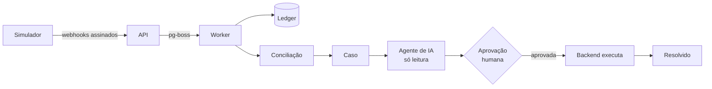

<div align="center">

# Reconcilia

**Encontra pagamentos que não batem entre loja, gateway e ERP, e um agente de IA investiga
cada caso. A IA sugere; uma pessoa aprova.**

Demo ao vivo (em construção) · Vídeo de 1 min (em construção) · Documentação da API (em construção)

[](https://github.com/devBandeiraa/reconcilia/actions/workflows/ci.yml)
[](https://github.com/devBandeiraa/reconcilia/releases)
[](LICENSE)
[](tsconfig.base.json)

<!-- GIF do fluxo completo: chega na fase 9 (docs/img/fluxo.gif) -->

</div>

> **Status:** v0.1.0. A base do monorepo está pronta (api, web, CI e qualidade). As seções
> marcadas como _em construção_ chegam nas próximas fases; veja o [roadmap](#roadmap).

## O problema

Uma venda passa por três sistemas que não conversam bem: a **loja** cria o pedido, o **gateway**
captura o pagamento e avisa por webhook, e o **ERP** registra o valor para o financeiro. Três
falhas aparecem sempre: o webhook de captura que **se perde** (cliente pagou, pedido segue
pendente), o webhook que chega **duplicado** (risco de baixar o pagamento duas vezes) e o
**valor divergente** entre gateway e ERP (juros de parcelamento, por exemplo). Na Backlgrs eram
mais de 15 incidentes por semana em 5 lojas, investigados um a um, na mão.

## Como funciona

_Em construção._ O fluxo planejado:



O simulador gera tráfego com falhas conhecidas e a api aplica cada evento exatamente uma vez. A
conciliação abre casos, o agente investiga com ferramentas só de leitura e sugere uma ação, que
só é executada depois que uma pessoa aprova.

## Destaques técnicos

- **Tipos compartilhados entre front e back.** A api valida a resposta do `/health` com
  `HealthResponseSchema` e a web consome o mesmo schema. Prova:
  [`packages/shared/src/health.ts`](packages/shared/src/health.ts),
  [`apps/api/test/health.test.ts`](apps/api/test/health.test.ts).
- **Env validado na inicialização.** A api e a web não sobem com env inválido. Prova:
  [`apps/api/test/env.test.ts`](apps/api/test/env.test.ts).
- **OpenAPI gerado do Zod**, sem duplicar o tipo em DTOs de classe. Prova:
  [`apps/api/src/common/openapi.ts`](apps/api/src/common/openapi.ts).
- Idempotência garantida no banco: _em construção (fase 4)_.
- Ledger em partidas dobradas que sempre fecha em zero: _em construção (fase 5)_.
- Conciliação validada contra o gabarito do simulador: _em construção (fase 6)_.
- Agente só de leitura, com no máximo 8 rodadas e saída validada por schema: _em construção
  (fase 7)_.
- Aprovação humana com execução idempotente e trilha de auditoria: _em construção (fase 8)_.

## Stack

| Camada       | Escolha                              | Por quê                                                                               | Limite do plano gratuito     |
| ------------ | ------------------------------------ | ------------------------------------------------------------------------------------- | ---------------------------- |
| Monorepo     | pnpm workspaces                      | Tipos compartilhados sem publicar pacote ([ADR 0001](docs/adr/0001-monorepo-pnpm.md)) | Sem custo                    |
| API e worker | NestJS 12 + pino + Swagger           | DI e módulos claros; o worker roda no mesmo processo                                  | Render Free (em construção)  |
| Web          | Next.js 16 (App Router) + Tailwind 4 | Renderização no servidor, deploy simples                                              | Vercel Hobby (em construção) |
| Contratos    | Zod 4                                | Um schema gera o tipo, a validação e o OpenAPI                                        | Sem custo                    |
| Banco        | PostgreSQL 17                        | Garantias no banco (constraints); fila no próprio Postgres                            | Neon (em construção)         |
| Testes       | Vitest + Supertest                   | Rápidos, com banco real via Docker Compose                                            | Sem custo                    |
| IA           | Gemini (`@google/genai`)             | Plano gratuito, atrás da interface `LlmClient`                                        | Em construção (fase 7)       |

## Rodando localmente

Pré-requisitos: Node 24 (veja [`.nvmrc`](.nvmrc)), Docker e pnpm 12. Para habilitar o pnpm:

```bash
corepack enable pnpm
```

Depois:

```bash
docker compose up -d
pnpm install
pnpm dev
```

| Serviço  | Endereço                                                |
| -------- | ------------------------------------------------------- |
| Web      | http://localhost:3000                                   |
| API      | http://localhost:3001/health                            |
| Swagger  | http://localhost:3001/docs                              |
| Postgres | `localhost:5440` (usuário, senha e banco: `reconcilia`) |

As variáveis de ambiente têm padrão para desenvolvimento local. Para mudar, copie
[`apps/api/.env.example`](apps/api/.env.example) para `apps/api/.env` e
[`apps/web/.env.example`](apps/web/.env.example) para `apps/web/.env.local`.

`pnpm db:reset` e o simulador: _em construção (fases 2 e 3)_.

## Testes

```bash
pnpm lint && pnpm typecheck && pnpm test
```

São 4 testes hoje: o contrato do `/health`, o OpenAPI publicado em `/docs` e a validação do env
(padrões e erro legível). Os testes de banco, idempotência e conciliação chegam nas próximas
fases.

## Arquitetura e decisões

```
apps/
  api/         NestJS: HTTP, worker (pg-boss) e agente
  web/         Next.js: telas de casos, diagnóstico e saúde
  simulator/   gerador de tráfego da loja, gateway e ERP
packages/
  shared/      schemas Zod e tipos (única fonte de DTOs)
docs/adr/      decisões de arquitetura
```

- [ADR 0001: monorepo com pnpm workspaces](docs/adr/0001-monorepo-pnpm.md)

## Limitações conhecidas

- Ainda não há banco, fila, conciliação nem agente: esta versão é a base do projeto.
- O TypeScript está fixado na 6.0 porque `typescript-eslint` e `@nestjs/swagger` ainda não
  aceitam a 7.0.

## Roadmap

| Versão | Entrega                                      | Status |
| ------ | -------------------------------------------- | ------ |
| v0.1.0 | Monorepo, CI, README inicial                 | ✅     |
| v0.2.0 | Modelo de dados com garantias no banco       | 🚧     |
| v0.3.0 | Gerador de tráfego e das 3 falhas            | 🚧     |
| v0.4.0 | Webhooks idempotentes + fila                 | 🚧     |
| v0.5.0 | Partidas dobradas                            | 🚧     |
| v0.6.0 | Detecção de divergências                     | 🚧     |
| v0.7.0 | Agente de IA investigador                    | 🚧     |
| v0.8.0 | Aprovação humana e execução                  | 🚧     |
| v0.9.0 | Telas em Next.js                             | 🚧     |
| v1.0.0 | No ar + README final                         | 🚧     |
| v1.1.0 | RAG com casos parecidos e runbook (opcional) | 🚧     |

## Autor

Jhordan Bandeira · LinkedIn (em construção) · [GitHub](https://github.com/devBandeiraa)
